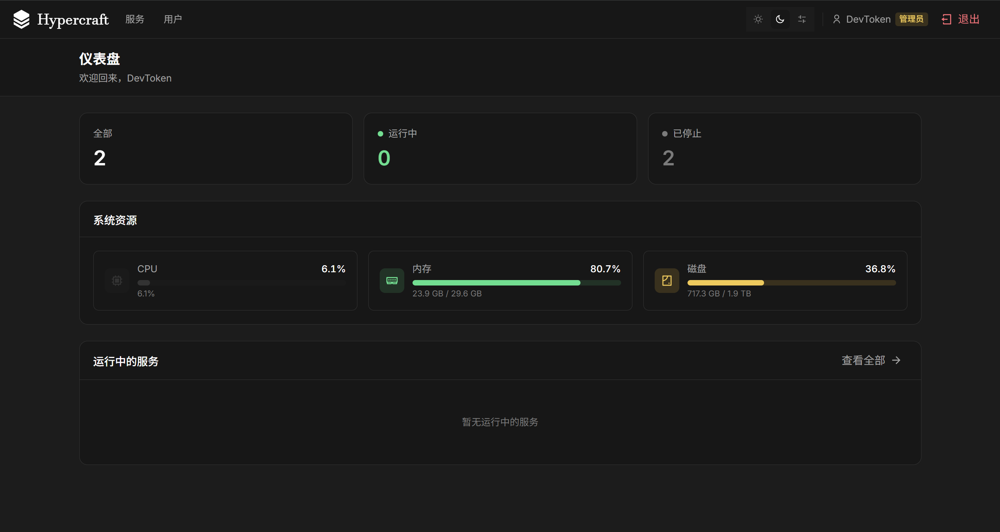
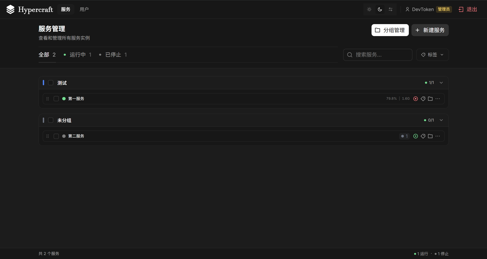
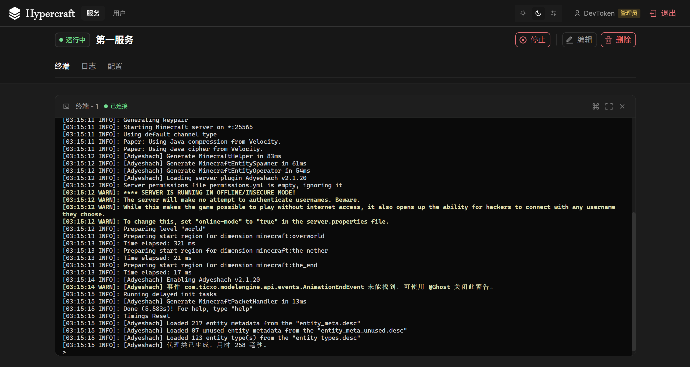

# Hypercraft

跨平台进程管理与监控系统，面向 Minecraft 服务端及其他需长期运行的进程。





## 功能概览

| 模块 | 说明 |
|------|------|
| 进程管理 | 启动 / 停止 / 重启 / 强杀；支持自动重启与优雅关闭指令 |
| 终端 | WebSocket + PTY attach，可交互输入输出 |
| 日志 | 历史截取、实时跟随（SSE）、自动截断 |
| 调度 | Cron 定时 start / stop / restart |
| 认证 | JWT 会话；DevToken 超管入口；Token 刷新与撤销 |
| 权限 | 超级管理员 / 系统管理员 / 普通用户；服务级 ACL |
| Agent API | 长期 API Key 与 `/agent/*` 运维面 |
| 安全策略 | 可执行命令白名单、工作目录前缀限制 |
| 运行环境 | 内嵌 mise 安装 Java（Temurin / Zulu / Corretto / Dragonwell / Kona …）、Node.js、Python、Go 等任意工具；每个服务可同时选择多个，支持国内镜像 |
| Web 控制台 | 服务分组、标签、拖拽排序、API Key 与接口测试 |

## 快速部署

配置统一使用仓库根目录 `.env`（模板：`.env.example`）。

### 预编译安装（推荐）

自 [Releases / main](https://github.com/Bkm016/hypercraft/releases/tag/main) 拉取二进制与 Web standalone，无需本机安装 Rust / Node。

```bash
# Linux / macOS
chmod +x install.sh && ./install.sh

# Windows PowerShell
.\install.ps1
```

| 模式 | 命令 | 前置条件 |
|------|------|----------|
| 预编译（默认） | `./install.sh` · `.\install.ps1` | 可访问 GitHub |
| Docker Compose | `--docker` · `-Docker` | Docker |
| 源码构建 | `--build` · `-Build` | Rust 1.75+、Node 20+、pnpm |
| 仅生成配置 | `--env-only` · `-EnvOnly` | — |
| 日志 / 停止 | `--logs` · `--down` | — |

安装完成后访问 `http://localhost:3000`，使用脚本输出的 `HC_DEV_TOKEN` 以超级管理员身份登录。

### 运行时目录

| 路径 | 用途 |
|------|------|
| `dist/` | 预编译 API / CLI 与 Web standalone |
| `data/` | 持久化数据、安装缓存、运行日志 |
| `services/` | 被托管进程的推荐工作目录 |
| `.env` | 运行时配置（勿提交版本库） |

### 源码开发

```bash
./install.sh --env-only          # 或 .\install.ps1 -EnvOnly
# Windows 可选用 .\dev.ps1 同时拉起前后端

cd backend && cargo run -p hypercraft-api
cd web && pnpm install && pnpm dev
```

API 与 CLI 自当前工作目录向上查找 `.env`。

## CLI

```bash
export HC_API_BASE=http://127.0.0.1:8080
# 或 export HC_DEV_TOKEN=...

hypercraft-cli list
hypercraft-cli get <id>
hypercraft-cli start|stop|restart <id>
hypercraft-cli attach <id>
hypercraft-cli logs <id> --follow
hypercraft-cli shell

hypercraft-cli schedule get|set|enable|disable|remove <id>
hypercraft-cli user list
hypercraft-cli user create -u <name> -p <password>
hypercraft-cli user grant|revoke <user-id> <service-id>
```

## Agent API

长期凭证格式：`hc_ak_<id>_<secret>`。  
API Key 可访问全部服务，能力由 `scopes` 控制。API Key **不具备**用户管理与超管能力。

### Scopes

| scope | 能力 |
|-------|------|
| `read` | 列表 / 详情 / 状态 |
| `control` | start / stop / restart / shutdown / kill |
| `manage` | 创建 / 更新 / 删除服务定义与分组 |
| `logs` | 日志 tail / follow |
| `attach` | WebSocket PTY |

### 管理端点（超级管理员 JWT）

| 方法 | 路径 | 说明 |
|------|------|------|
| `GET` | `/api-keys` | 列表 |
| `POST` | `/api-keys` | 创建 |
| `GET` | `/api-keys/:id` | 摘要 |
| `GET` | `/api-keys/:id/secret` | 查看完整密钥（加密存储） |
| `PATCH` | `/api-keys/:id` | 更新 scopes / 名称 |
| `POST` | `/api-keys/:id/rotate` | 重置密钥 |
| `DELETE` | `/api-keys/:id` | 撤销 |

系统管理员 JWT **不能**调用上表；Web 控制台 `/api-keys`、`/api-test` 亦仅超级管理员可用。

### Agent 分组与服务入组

| 方法 | 路径 | scope |
|------|------|-------|
| `GET` | `/agent/groups` | `read` |
| `POST` | `/agent/groups` | `manage` |
| `POST` | `/agent/groups/reorder` | `manage` |
| `PATCH` | `/agent/groups/:id` | `manage` |
| `DELETE` | `/agent/groups/:id` | `manage` |
| `PATCH` | `/services/:id/group` | `manage` |

分配服务到分组（`group` 为分组 id；`null` 表示移出分组）：

```bash
curl -X PATCH -H "Authorization: Bearer $HC_API_KEY" \
  -H "Content-Type: application/json" \
  -d '{"group":"default"}' \
  "$HC_API/services/<service-id>/group"
```

Web 控制台：`/api-keys`（密钥管理）、`/api-test`（接口联调，仅超管）。

### 调用示例

```bash
export HC_API=http://127.0.0.1:8080
export HC_API_KEY=hc_ak_...

curl -H "Authorization: Bearer $HC_API_KEY" "$HC_API/agent/me"
curl -H "Authorization: Bearer $HC_API_KEY" "$HC_API/agent/help"
curl -H "Authorization: Bearer $HC_API_KEY" "$HC_API/agent/services"
curl -H "Authorization: Bearer $HC_API_KEY" "$HC_API/agent/groups"

curl -X POST -H "Authorization: Bearer $HC_API_KEY" \
  -H "Content-Type: application/json" \
  -d '{"id":"default","name":"Default"}' \
  "$HC_API/agent/groups"

curl -X PATCH -H "Authorization: Bearer $HC_API_KEY" \
  -H "Content-Type: application/json" \
  -d '{"group":"default"}' \
  "$HC_API/services/<service-id>/group"

curl -X POST -H "Authorization: Bearer $HC_API_KEY" \
  "$HC_API/agent/services/<id>/restart"

curl -H "Authorization: Bearer $HC_API_KEY" \
  "$HC_API/agent/services/<id>/logs?tail=100"

curl -N -H "Authorization: Bearer $HC_API_KEY" \
  "$HC_API/agent/services/<id>/logs?follow=true"

# WebSocket: ws://127.0.0.1:8080/agent/services/<id>/attach?token=$HC_API_KEY
```

同一 Key 亦可调用 `/services/*`；日志纯文本：`/services/:id/logs?format=text`。

## 环境变量

| 变量 | 说明 | 默认 |
|------|------|------|
| `HC_DATA_DIR` | 数据目录 | `./data` |
| `HC_BIND` | API 监听地址 | `0.0.0.0:8080` |
| `HC_API_BASE` | CLI 默认 API 地址 | `http://127.0.0.1:8080` |
| `HC_DEV_TOKEN` | 超级管理员口令（≥32 字符） | 未设置则每次启动随机生成 |
| `HC_JWT_SECRET` | JWT 签名密钥 | 未设置则每次启动随机生成 |
| `HC_JWT_ISSUER` | JWT iss | `hypercraft-api` |
| `HC_JWT_AUDIENCE` | JWT aud | `hypercraft-clients` |
| `HC_ACCESS_TOKEN_TTL` | Access Token 有效期（秒） | `21600` |
| `HC_REFRESH_TOKEN_TTL` | Refresh Token 有效期（秒） | `604800` |
| `HC_ALLOWED_COMMANDS` | 可执行命令白名单（逗号分隔） | 见 `.env.example` |
| `HC_ALLOWED_CWD_PREFIXES` | 工作目录白名单（本机分号分隔） | 空则按实现放宽 |
| `HC_CORS_ORIGINS` | 前端 Origin 列表（禁止 `*`） | 本地 `3000` |
| `HC_WEB_GATEWAY_BASE_DOMAIN` | Web 网关基础域（无协议） | — |
| `NEXT_PUBLIC_API_URL` | 浏览器侧 API 基址 | `http://localhost:8080` |
| `HC_API_PORT` / `HC_WEB_PORT` | Compose 宿主机端口映射 | `8080` / `3000` |
| `HC_MISE_BIN` | mise 可执行文件路径 | PATH 中的 `mise`（Docker 镜像内置） |
| `HC_JAVA_MIRROR` | Temurin 下载镜像初始值：`official` / `tuna` / `ustc` | `official` |
| `HC_GITHUB_PROXY` | GitHub Release 代理前缀初始值，如 `https://ghfast.top/` | — |
| `HC_CN_MIRRORS` | Node.js / Python / Go 使用国内镜像初始值 | Temurin 用国内镜像时为 `true` |
| `RUST_LOG` | 日志级别 | `info` |

## 运行环境

管理员在 Web 控制台「环境」页安装与管理运行环境，创建服务时可**同时选择多个**（如 Java 21 + Node.js 22 + Python 3.12）。

- 由内嵌 [mise](https://mise.jdx.dev) 安装，支持 mise registry 中的任意工具；Java 提供「主版本 × 发行版」选择器，其他工具按版本通道（如 Node 22 / Python 3.12）或完整版本选择。
- 数据隔离在 `<HC_DATA_DIR>/mise`，不影响主机上的 mise。
- 下载源（写入 mise `url_replacements`，具体规则优先于通用代理）：
  - Java Temurin：清华 TUNA / 中科大 / 官方
  - Node.js / Python / Go：npmmirror、golang.google.cn（「国内镜像」开关）
  - 其他 GitHub Release（Dragonwell、Kona、Bun、Gradle …）：可配置 GitHub 代理前缀
- 服务启动时按所选顺序把各环境的 bin 目录前置到 `PATH`，并注入其环境变量（`JAVA_HOME`、`GOROOT` 等），排在前面的优先；同一工具只能选一个。裸命令（`java`、`node` …）优先在所选环境中解析。
- 安装任务可取消（自动清理半成品）、删除单条或一键清理已结束记录；「清理」可释放下载缓存并卸载未登记的残留安装。
- 也可「登记 JDK」使用服务器上现成的 JDK / JRE 目录（只登记，不复制）。
- 正在被服务使用的运行环境不能删除。

| 方法 | 路径 | 权限 |
|------|------|------|
| `GET` | `/runtimes[?tool=java]` | 已登录（`read`） |
| `GET` | `/runtimes/tools` · `/runtimes/tools/:tool/versions` | 管理员 |
| `GET` | `/runtimes/java/catalog` | 管理员 |
| `POST` | `/runtimes/install` `{"tool":"node","spec":"22"}` | 管理员 |
| `GET` / `DELETE` | `/runtimes/tasks`（DELETE 清理已结束） | 管理员 |
| `GET` / `DELETE` | `/runtimes/tasks/:id` · `POST /runtimes/tasks/:id/cancel` | 管理员 |
| `GET` | `/runtimes/storage` · `POST /runtimes/cleanup` `{"tasks","cache","orphans"}` | 管理员 |
| `POST` | `/runtimes` `{"id","home","name?"}` 登记已有 JDK | 管理员 |
| `PATCH` / `DELETE` | `/runtimes/:id` | 管理员 |
| `GET` / `PUT` | `/runtimes/settings` 下载源 | 管理员 |

服务清单中使用 `"runtimes": ["<运行环境 ID>", ...]` 引用（旧字段 `java_runtime` 仍可读取）。

## 服务清单示例

```json
{
  "id": "minecraft-server",
  "name": "Minecraft Server",
  "command": "java",
  "runtimes": ["temurin-jre-21", "node-22"],
  "args": ["-Xmx4G", "-jar", "server.jar", "nogui"],
  "cwd": "/opt/minecraft",
  "env": {
    "JAVA_HOME": "/usr/lib/jvm/java-17"
  },
  "auto_start": false,
  "auto_restart": true,
  "shutdown_command": "stop",
  "tags": ["game", "production"],
  "schedule": {
    "enabled": true,
    "cron": "0 0 8 * * *",
    "action": "start"
  }
}
```

## systemd（Linux）

将 Release 中的 API 二进制与 Web standalone 分别部署，例如：

- API：`/opt/hypercraft/backend/hypercraft-api`
- Web：`/opt/hypercraft/web`（含 `node`、`server.js`）
- 配置：`/opt/hypercraft/.env`

```ini
# /etc/systemd/system/hypercraft-api.service
[Unit]
Description=Hypercraft API
After=network-online.target
Wants=network-online.target

[Service]
Type=simple
User=hypercraft
Group=hypercraft
WorkingDirectory=/opt/hypercraft/backend
EnvironmentFile=/opt/hypercraft/.env
ExecStart=/opt/hypercraft/backend/hypercraft-api
Restart=always
RestartSec=5

[Install]
WantedBy=multi-user.target
```

```ini
# /etc/systemd/system/hypercraft-web.service
[Unit]
Description=Hypercraft Web
After=network-online.target hypercraft-api.service
Wants=network-online.target

[Service]
Type=simple
User=hypercraft
Group=hypercraft
WorkingDirectory=/opt/hypercraft/web
Environment=PORT=3000
Environment=HOSTNAME=0.0.0.0
ExecStart=/opt/hypercraft/web/node /opt/hypercraft/web/server.js
Restart=always
RestartSec=5

[Install]
WantedBy=multi-user.target
```

```bash
sudo systemctl daemon-reload
sudo systemctl enable --now hypercraft-api hypercraft-web
systemctl status hypercraft-api hypercraft-web
journalctl -u hypercraft-api -f
```

修改 `.env` 或替换二进制后需 `systemctl restart` 对应单元。健康检查：`curl -fsS http://127.0.0.1:8080/health`。

## 反向代理与跨域

浏览器会话使用带凭据 Cookie，`HC_CORS_ORIGINS` 必须为面板实际 Origin（协议 + 主机 + 非默认端口），不得使用 `*`。

```bash
# .env
HC_CORS_ORIGINS=https://panel.example.com
NEXT_PUBLIC_API_URL=https://api.example.com
# 可选：服务页子域网关
# HC_WEB_GATEWAY_BASE_DOMAIN=hyper.example.com
```

```nginx
server {
    listen 443 ssl;
    server_name api.example.com;
    location / {
        proxy_pass http://127.0.0.1:8080;
        proxy_set_header Host $host;
        proxy_set_header X-Real-IP $remote_addr;
        proxy_http_version 1.1;
        proxy_set_header Upgrade $http_upgrade;
        proxy_set_header Connection "upgrade";
    }
}

server {
    listen 443 ssl;
    server_name panel.example.com;
    location / {
        proxy_pass http://127.0.0.1:3000;
        proxy_set_header Host $host;
        proxy_set_header X-Real-IP $remote_addr;
    }
}
```

Web Gateway 子域需配置通配 DNS、TLS 及至 API 的反代。

## 仓库结构

```
hypercraft/
├── backend/                 # Rust workspace
│   ├── hypercraft-core/     # 进程与用户核心库
│   ├── hypercraft-api/      # HTTP / WebSocket API
│   └── hypercraft-cli/      # 命令行客户端
├── web/                     # Next.js 控制台
├── docker/                  # 容器构建与入口
├── install.sh / install.ps1 # 安装与启停
├── docker-compose.yml
└── .env.example
```

## 许可证

MIT
